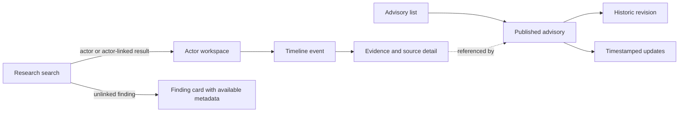

# WATCHTOWER V1 UI experience and API contract

Status: proposed for owner review.
Date: 2026-10-21.
Tracking: Task 29, Jira `SCRUM-17`, parent epic `SCRUM-16`.

## Product outcome

The V1 interface gives a threat-intelligence researcher one evidence-first path:

1. search published intelligence;
2. select an actor or an actor-linked finding;
3. understand the actor's aliases, behavior and chronology;
4. inspect the source and evidence for each claim; and
5. read published advisories and their timestamped updates.

The interface is for local/private evaluation of the completed backend. It is a
read-only research surface. It does not add an editorial console, ingestion
controls, raw-artifact browsing, STIX export controls, RAG controls or token
entry. Those operations retain their existing API/CLI boundary until a later
contract approves the workflow and identity model.

## Users and primary jobs

The primary user is a threat-intelligence researcher who needs to answer:

- What published intelligence matches this name, alias, technique or behavior?
- Which actor is connected to the finding?
- What changed over time, and is each item observed or assessed?
- Which source and evidence support the claim?
- Has a published advisory changed since it was first released?

A security lead is a secondary read-only user. They can follow an advisory and
inspect its evidence without learning the operator APIs.

V1 has no browser-based administrator persona. Local operators continue to use
the documented authenticated API and CLI flows.

## Experience principles

- **Evidence is adjacent to the claim.** Citations, source, capture time and
  confidence are visible from each timeline item without navigating to an
  unrelated page.
- **Observed and assessed are explicit.** Every typed observation, advisory
  section and update includes a word label and an icon. Color is supporting
  information only.
- **Publication rules are inherited.** The UI only calls public read endpoints.
  Internal records, drafts and unpublished revisions never enter its data
  model.
- **Missing data stays missing.** The UI uses `Not supplied`, `Unknown` or an
  absent field; it does not infer dates, confidence, relationships or labels.
- **URLs preserve research context.** Search terms, filters, actor timeline
  filters and advisory revision selection are URL parameters or route segments.
- **Text is untrusted data.** Source content is rendered as text. V1 does not
  parse API content as HTML or Markdown.

## Information architecture

The product has two top-level destinations and one stable home redirect:

| Route | Purpose | Navigation label |
| --- | --- | --- |
| `/` | Redirect to `/search` | none |
| `/search` | Search and filter published intelligence | Research |
| `/actors/[actorId]` | Actor summary, aliases, associations, timeline and evidence | contextual |
| `/advisories` | Browse published advisory summaries | Advisories |
| `/advisories/[slug]` | Read the current published revision and ordered updates | contextual |
| `/advisories/[slug]/revisions/[version]` | Read a durable historic published revision | contextual |

The desktop shell uses a compact header with the WATCHTOWER wordmark, Research
and Advisories links, and a visible `Local/private` environment label. Mobile
uses the same links in a two-item navigation row; it does not hide primary
navigation behind a menu.

## Screen contract

### Research search

The page opens with a prominent search field and a short example such as
`Search actors, aliases, techniques, behaviors or observations`. A query is
submitted only when it contains at least two non-whitespace characters.

Filters are progressive rather than always expanded:

- entity type: actor, alias, campaign, behavior, technique, observation, source;
- intelligence type: observed or assessed;
- source ID;
- UTC-aware start and end date; and
- page size, fixed to 25 in the first UI.

The result header repeats the normalized API query. Result cards show the
entity type, title, summary when supplied, match kind, and relevant metadata.
`OBSERVED` or `ASSESSED` appears whenever `intelligence_type` is present. An
external technique ID, source reference and observed date appear only when
returned.

Actor results open `/actors/[id]`. Alias, campaign, behavior, technique and
observation results open the actor workspace only when `actor_id` is returned.
The target carries `fromSearch` query context so Back returns to the same
search. Results without an `actor_id` remain complete result cards because the
backend has no public standalone entity detail route. The UI must not invent
one or use an operator endpoint.

`next_cursor` produces a `Load more results` button. Appended results retain the
API order. The cursor stays opaque, is never decoded and is cleared when any
filter changes.

### Actor workspace

The actor page begins with canonical name and description. Its desktop layout
uses a main research column and a narrower context rail; mobile stacks every
section in the order below.

1. **Identity:** canonical name, description and source-preserved aliases.
2. **Association summary:** techniques and behaviors. Technique items retain
   both external ID and name.
3. **Timeline controls:** UTC-aware date range and observed/assessed filter.
4. **Timeline:** newest-first observation cards with title, summary, observed
   time, first/last seen when supplied, confidence, source, behaviors,
   techniques and expandable evidence.
5. **Reference rail:** distinct sources and evidence references returned by
   the actor reference endpoint.

Each observation visibly pairs the intelligence label with origin:
`OBSERVED · imported` or `ASSESSED · watchtower`. Evidence entries show
citation, excerpt, locator, capture time, confidence and source. A locator is a
clickable external link only when it parses as an absolute `https` or `http`
URL. External links open in a new tab with `noopener noreferrer`. Other locator
values render as selectable text.

The page shows each backend truncation flag next to its affected collection,
for example `Additional evidence is available through the API`. It never
presents a truncated collection as complete.

Timeline pagination uses `Load earlier events`. Filters clear the timeline
cursor and reload page one. The opaque cursor never enters a human-readable
control.

### Advisory list

The list shows published advisory cards ordered exactly as returned by the API.
Each card contains title, summary, publication time, published revision and the
latest update time when present. The page requests 25 items. The current API
does not expose a cursor, so the UI does not promise full pagination or local
sorting.

### Advisory detail and history

The current advisory page displays title, summary, revision number,
publication time, linked actors/campaigns/techniques, typed sections, evidence
and ordered updates. Section and update labels use the same observed/assessed
component as the actor timeline.

Section content and update summaries render as plain text with preserved
paragraph breaks. Evidence references display citation and excerpt; their
contract does not include a locator, so the UI does not fabricate a source
link. Actor links open the public actor route. Technique and campaign links are
labels because no public detail routes exist.

When a user selects a known published version, the UI uses the historic route
and clearly labels it `Archived published revision vN`. The current revision
remains one action away. Earlier publication is durable in the current backend;
the UI does not claim that it can withdraw an advisory.

## Responsive layouts

Desktop begins at 1024 CSS pixels. Content is capped at 1440 pixels and uses a
12-column grid. Search results use eight columns; filters use four. Actor pages
use eight columns for the timeline and four for references.

Tablet uses one primary column with a two-column metadata grid. Mobile at less
than 640 pixels uses one column, full-width controls and horizontally wrapping
metadata. Filters open in an accessible dialog on mobile. Long UUIDs, locators,
citations and technique IDs wrap without forcing horizontal page scrolling.

The interface must remain usable at 320 CSS pixels and at 200% browser zoom.

## API mapping

The SvelteKit server is the API-client boundary. Browser code calls same-origin
SvelteKit load functions or `/api` proxy handlers; only server code knows the
backend origin. `WATCHTOWER_API_ORIGIN` is a private runtime environment value,
defaults to `http://127.0.0.1:8000` in development, and never appears in a
client bundle.

| UI need | Backend request | Notes |
| --- | --- | --- |
| Search | `GET /api/v1/search` | Pass supported filters and opaque cursor unchanged |
| Actor identity | `GET /api/v1/actors/{actor_id}` | A 404 is a single unavailable state for absent and internal actors |
| Aliases | `GET /api/v1/actors/{actor_id}/aliases` | Surface `truncated` |
| Associations | `GET /api/v1/actors/{actor_id}/associations` | Surface both truncation flags |
| Timeline | `GET /api/v1/actors/{actor_id}/timeline` | Pass date/type filters and opaque cursor |
| References | `GET /api/v1/actors/{actor_id}/references` | Surface both truncation flags |
| Advisory list | `GET /api/v1/advisories?limit=25` | Published summaries only |
| Current advisory | `GET /api/v1/advisories/{slug}` | Published revision only |
| Historic revision | `GET /api/v1/advisories/{slug}/revisions/{version}` | Published historic revisions only |
| Advisory updates | `GET /api/v1/advisories/{slug}/updates` | Request pages by `after_sequence`; append by sequence |

The client owns hand-written TypeScript types matching these stable response
schemas. A later task may generate them from OpenAPI only if generation is
deterministic, reviewed and produces no runtime dependency. Every API failure
normalizes to `{ status, code, message, requestId, details }`; unknown or
non-JSON failures use a generic message and retain the HTTP status.

The client sends a new valid `X-Request-ID` for each server-side backend call
and displays the returned request ID in error details. Timeouts are bounded to
10 seconds for page data. Aborting browser navigation cancels pending UI work.
Automatic retries are limited to one idempotent GET after a network failure;
4xx and 5xx responses are not retried automatically.

Actor page loads are independent after the required actor identity succeeds.
Aliases, associations, timeline and references run concurrently. One failed
secondary panel shows its own error and retry action while successful panels
remain usable.

## Loading, empty and failure states

| State | Required presentation |
| --- | --- |
| Initial search | Example query and supported entity types; no fake results |
| Search loading | Preserve query/filters, disable duplicate submit, show labelled result skeletons |
| No search matches | `No published intelligence matched this search` plus clear-filter action |
| Empty actor timeline | Keep actor identity visible; say no published events match current filters |
| Empty advisories | Say no advisories have been published; never mention drafts |
| Partial actor page | Keep successful panels; failed panel contains Retry and request ID disclosure |
| 404 actor/advisory | `This published record is unavailable`; do not distinguish private from absent |
| 422 | Put valid field messages beside controls and expose general API message |
| 429 | Ask the user to wait before retrying; preserve current data and controls |
| 500/network/timeout | Generic unavailable message, Retry, and request ID when returned |
| API not ready | Explain how to start/check the local backend and provide a Retry action |

Stale data remains visible during `Load more` and panel retries. A failure must
not replace already loaded evidence with an empty state.

## Authentication and security

V1 browser routes use only the public published-read API. The UI has no token
field and stores no operator token, bearer token or backend secret in cookies,
`localStorage`, `sessionStorage`, URL parameters, logs or client-visible
configuration. Operator APIs remain inaccessible from the UI.

Future OIDC UI work must use an authorization-code flow with PKCE and a
server-managed `HttpOnly`, `Secure`, `SameSite=Lax` session. It must receive a
separate design and threat-model review before implementation.

The SvelteKit server validates route parameters and allowlists query keys before
calling the backend. It does not accept an arbitrary backend URL. Responses use
a restrictive Content Security Policy, deny framing, avoid third-party fonts or
scripts and render API strings through Svelte text interpolation. Logs include
route, status and request ID, never query text, evidence content or headers.

## Accessibility

Acceptance targets WCAG 2.2 AA for the implemented flow:

- semantic landmarks, one page-level heading and a skip link;
- visible focus and logical keyboard order;
- labelled search, filters, dialogs, disclosure controls and retry actions;
- status changes announced through restrained `aria-live` regions;
- observed/assessed and success/error states conveyed by text and icon as well
  as color;
- minimum 4.5:1 text contrast and 3:1 large-text/control contrast;
- touch targets at least 44 by 44 CSS pixels where controls are not inline;
- no required drag, hover-only content or time-limited interaction;
- reduced-motion support with no nonessential animation; and
- dates rendered in the user's locale with a discoverable UTC value.

Automated accessibility checks cover representative pages, and keyboard/manual
checks cover search, filters, pagination, evidence disclosure and navigation.

## Visual direction

The interface should feel like a calm research workspace rather than a generic
security dashboard. It uses a light neutral canvas, white evidence surfaces, a
dark ink header and restrained blue actions. Dense metadata stays subordinate
to claims and citations.

Initial design tokens:

| Role | Value |
| --- | --- |
| Canvas | `#F4F6F8` |
| Surface | `#FFFFFF` |
| Ink | `#18202B` |
| Muted ink | `#566273` |
| Border | `#CFD6DF` |
| Primary action | `#245EA8` |
| Observed | `#176B5A` with eye icon and `OBSERVED` text |
| Assessed | `#8A520F` with analysis icon and `ASSESSED` text |
| Error | `#A53636` |

Use the native system sans-serif stack and system monospace for IDs and
locators; V1 downloads no fonts. Corners are modest (6-10 pixels), shadows are
subtle and motion is limited to state transitions shorter than 150 ms.

ECharts is permitted only for a complete, meaningful series. The current
cursor-paginated API cannot truthfully provide aggregate timeline charts, so the
first implementation does not add a chart. A future chart must use tree-shaken
modules, a text summary, a keyboard-accessible data table, non-color labels and
reduced-motion behavior. It must never chart a partial page as if it were the
complete dataset.

## Frontend foundation

The first implementation task creates `apps/web` with these reviewed baseline
versions, recorded on 2026-10-21 and pinned in `pnpm-lock.yaml`:

| Tool | Selected baseline |
| --- | --- |
| Node.js | 24.x LTS (`>=24.0 <25`) |
| pnpm | 12.14.0 |
| Svelte | 5.57.2 |
| SvelteKit | 3.1.0 |
| TypeScript | 6.0.3, satisfying SvelteKit 3's TypeScript 6 peer range |
| Vite | 8.3.4 |
| Tailwind CSS / Vite plugin | 4.3.3 |
| shadcn-svelte CLI | 1.7.0; generated components are owned source |
| SvelteKit Node adapter | 6.0.0 |
| Vitest | 5.0.5 |
| Testing Library for Svelte | 5.4.2 |
| Playwright | 1.64.1 |

Exact transitive versions come only from the committed lockfile. The scaffold
must validate these candidate pins together before they become the repository
baseline. ECharts 6.1.0 is approved when a qualifying complete-series screen is
implemented; it is not installed preemptively.

The package scripts are `dev`, `build`, `preview`, `check`, `lint`, `format:check`,
`test:unit` and `test:e2e`. CI uses Corepack, a frozen lockfile and Node 24. It
runs type/Svelte checks, lint/format checks, unit tests, a production build and
the representative Playwright researcher journey. Frontend checks are a new
job and do not weaken or replace any backend, dependency or container job.

## Test and acceptance matrix

| Level | Required proof |
| --- | --- |
| Unit | API error normalization, URL/filter serialization, intelligence labels, safe locator handling, date formatting |
| Component | Search results, timeline/evidence card, partial panel failure, advisory sections/updates, empty and error states |
| Contract fixtures | Representative public API payloads for every screen; TypeScript catches schema drift in fixture compilation |
| End to end | Search published actor -> actor timeline -> expand evidence -> navigate to advisory -> read update |
| Accessibility | Automated scan plus keyboard/focus/manual checks of the end-to-end path |
| Responsive | 320 px mobile, 768 px tablet, 1440 px desktop and 200% zoom |
| Security | No token entry/storage, no raw HTML rendering, CSP present, external-link protections, private API origin absent from client bundle |

The V1 UI is accepted when the end-to-end journey works against a deterministic
published local fixture, every loading/empty/partial/error state above has a
testable presentation, frontend CI passes with the unchanged backend jobs, and
the owner reviews the rendered desktop and mobile interface.

## Implementation slices after approval

1. **Task 30 — foundation:** scaffold `apps/web`, same-origin server API client,
   design tokens, shared shell, typed fixtures, checks and frontend CI.
2. **Task 31 — researcher flow:** implement search, actor workspace, evidence
   disclosure, pagination, filters and deterministic published demo data.
3. **Task 32 — advisories:** implement list, current/historic detail, updates
   and cross-links to actors.
4. **Task 33 — acceptance hardening:** responsive and accessibility review,
   browser tests, security headers, Docker/local orchestration and clean setup
   documentation.

Owner approval of this contract is the review checkpoint before Task 30 starts.

