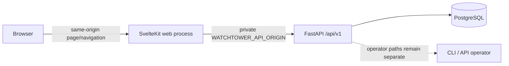
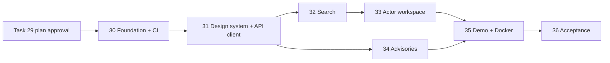

# WATCHTOWER V1 UI development master plan

Status: proposed for owner review; no frontend implementation has started.
Date: 2026-10-21.
Program: Jira `SCRUM-16`.
Planning task: Task 29 / Jira `SCRUM-17`.

## Purpose

This is the complete execution plan for the WATCHTOWER V1 user interface. It
defines the architecture, fixed task sequence, deliverables, acceptance gates,
validation commands and review points before the first frontend dependency or
runtime file is added.

The implementation follows the accepted experience contract in
[WATCHTOWER V1 UI experience and API contract](../../design/v1-ui-experience.md).
Changes to product scope, public visibility, authentication or backend
semantics require an explicit plan amendment and owner review; they are not
routine implementation choices.

## References reviewed

The plan was derived from the complete supplied `Instructions/TASK_00` through
`TASK_18` bundle, not only the documents that mention a frontend.

| Supplied task | UI requirement carried forward |
| --- | --- |
| Task 00 | Preserve the adversary-first `Adversary -> Behavior -> Evolution -> Context -> Evidence -> Interpretation -> Action` model, selected SvelteKit/TypeScript/shadcn-svelte/Tailwind/ECharts stack and OBSERVED/ASSESSED/FORECAST separation. |
| Task 01 | Keep one coherent repository, typed configuration, repeatable local setup and Docker-backed dependencies; the UI adds no premature service. |
| Task 02 | Display stable IDs, timestamps, confidence, origin, intelligence type, source and evidence without changing the core data model. |
| Task 03 | Keep raw evidence immutable and private; show only public evidence references returned by approved read APIs. |
| Task 04 | Treat connector/source content as untrusted data and retain source provenance; never turn displayed content into a fetch target. |
| Task 05 | Preserve normalized facts and rejection boundaries; the UI does not silently repair or reinterpret malformed/missing data. |
| Task 06 | Respect conservative actor resolution and source-preserved aliases; provide no fuzzy merge action. |
| Task 07 | Use the actor, alias, observation, timeline, association and reference API contracts as implemented. |
| Task 08 | Keep administrative ingestion private and replay-safe; add no ingestion control to the V1 browser. |
| Task 09 | Use deterministic PostgreSQL search as the normal discovery path and preserve its ranking/filter behavior. |
| Task 10 | Keep RAG disabled unless separately configured and evaluated; do not imply live AI answers. |
| Task 11 | Keep raw technical artifacts operator-only and outside the public researcher UI. |
| Task 12 | Keep STIX export operator-only; do not add an unauthenticated export control. |
| Task 13 | Preserve bounded read requests, query limits, cursor behavior and measured API assumptions. |
| Task 14 | Add no unmeasured queue/service/cache and do not make the UI part of ingestion execution. |
| Task 15 | Render untrusted content safely, preserve stable failures and extend security controls to the browser boundary. |
| Task 16 | Extend CI and Docker validation without replacing existing jobs; keep deployment and rollback claims truthful. |
| Task 17 | Show published advisory history, typed sections, evidence and updates while keeping drafts private. |
| Task 18 | Close the evidenced usable-UI release gap and avoid declaring readiness until the integrated flow passes. |

The following current repository references also control the UI work:

- [CyberNetSec.io](https://cyber.netsecops.io/) is the owner-supplied visual
  reference. Its home, advisory-list and advisory-detail routes were reviewed
  on 2026-10-21. The plan carries forward its dark navy intelligence-workspace
  feel, cyan/violet accent family, outlined panels, compact status chips and
  strong technical hierarchy. It deliberately does not copy its branding,
  content, page composition, background artwork, promotional controls, heavy
  glow or unsupported aggregate metrics.
- [V1 scope](../../product-specs/v1-scope.md) makes a local/private first-party
  UI part of V1.
- [V2 productionization scope](../../product-specs/v2-productionization-scope.md)
  defers public AWS deployment and operational proof.
- [Canonical publication visibility](../../design/publication-visibility.md)
  makes public actor/search reads fail closed.
- [Threat model](../../security/threat-model.md) and
  [production boundary](../../security/production-boundary.md) control content,
  credential, host and future identity behavior.
- Root `README.md`, `SETUP.md`, `HOW_TO_USE_WITH_CODEX.md`, `.env.example`,
  `compose.yaml`, `Dockerfile` and `AGENTS.md` control developer workflow,
  validation, local services and task transitions.

## Fixed V1 boundary

V1 UI includes:

- deterministic published-intelligence search;
- actor identity, aliases, techniques, behaviors, timeline and evidence;
- source/provenance detail adjacent to claims;
- published advisory list, current/historic revisions and updates;
- desktop and mobile layouts;
- loading, empty, partial and error behavior;
- WCAG 2.2 AA-oriented implementation and keyboard flow;
- deterministic local demonstration data;
- frontend CI and local Docker/browser instructions.

V1 UI excludes:

- ingestion, queue, raw-artifact or STIX-export controls;
- advisory authoring, publishing or withdrawal;
- operator token entry, static-token storage or OIDC sign-in;
- live RAG/model execution;
- publication-state mutation;
- charts derived from incomplete cursor pages;
- new backend entity-detail routes;
- AWS deployment or an internet-facing readiness claim.

## Architecture fixed before implementation

### Repository and process boundary

- Frontend source lives in `apps/web` as one SvelteKit application.
- The committed package manager is pnpm, pinned by the root `packageManager`
  field, with one `pnpm-lock.yaml` at the repository root. CI installs it with a
  commit-pinned pnpm setup action. The current Windows host has Node 24 but no
  `npm` or `corepack`; Task 30 must provision the official pnpm 12.14.0
  standalone executable under ignored `.tools/bin` before running local checks.
- Node is pinned to major 24. Package versions are those approved in the UI
  contract and validated together during Task 30.
- `apps/web` uses the SvelteKit Node adapter. It is one UI process, not a new
  independently owned service or a replacement API.
- The Python backend remains authoritative for validation, visibility, ordering
  and error semantics.

### Request boundary



- Browser code never receives the backend origin and never calls FastAPI
  directly. This avoids a second CORS and credential boundary.
- SvelteKit server load functions call the public backend routes through one
  typed client in `apps/web/src/lib/server/api`.
- `WATCHTOWER_API_ORIGIN` is a private server environment variable. Development
  defaults to `http://127.0.0.1:8000`; production-like Docker uses the backend
  service name on the private Compose network.
- Public browser URLs hold search/filter state but never a backend cursor,
  secret or arbitrary upstream URL. Cursor state remains server-side in the
  active page interaction.
- Each backend request has a bounded timeout, a generated `X-Request-ID` and at
  most one network-only retry for an idempotent GET.

### Frontend structure

```text
apps/web/
  src/
    lib/
      components/       # owned UI components and shadcn-svelte source
      domain/           # labels, safe formatters and view models
      server/api/       # private backend client, types and error normalization
      styles/           # tokens and global styles
    routes/
      +layout.svelte
      +layout.server.ts
      +page.server.ts   # redirect / to /search
      search/
      actors/[actorId]/
      advisories/
      advisories/[slug]/
      advisories/[slug]/revisions/[version]/
    app.html
  static/
  tests/
    fixtures/
    unit/
    component/
    e2e/
  Dockerfile
```

Route-owned files compose screens. Reusable display behavior belongs in
components or domain helpers. Only `lib/server` reads private environment values
or calls the backend. API transport types are kept separate from view models so
formatting never changes the source payload.

### Visual and component policy

- Use the approved light research-workspace tokens and native system fonts.
- Add only the shadcn-svelte component source used by a committed screen.
- Build a shared intelligence label, evidence disclosure, source label, error
  panel, empty state, pagination action and loading skeleton once.
- OBSERVED and ASSESSED always use text plus icon; FORECAST is not a V1 value.
- Long untrusted values wrap. Text interpolation is used; no raw HTML action,
  Markdown renderer or arbitrary URL component is allowed.
- ECharts stays uninstalled until an API supplies a complete chartable series.

## Execution rules for every UI task

Before each task:

1. Verify the previous task's final files, diff, acceptance criteria and exact
   hosted CI result as required by `AGENTS.md`.
2. Record that verification in the new task's execution plan.
3. Work on a `codex/task-NN-*` branch based on current protected `main`.
4. Keep changes inside the stated task boundary. Amend this master plan before
   adding a new screen, backend semantic, auth flow or dependency category.

Before review:

1. Run the task-specific commands below and `git diff --check`.
2. Inspect the rendered result at desktop and mobile sizes when the task changes
   a screen.
3. Record skipped or blocked checks as such; never call them passed.
4. Push a sensible commit, require the final branch CI result, and update its
   Jira ticket with evidence.
5. Merge only after the task's owner review checkpoint when one is listed.

## Task 30 — frontend foundation and CI

### Goal

Create a reproducible, empty-but-running SvelteKit foundation and add frontend
quality gates without implementing product screens.

### Deliverables

- Create `apps/web` with Svelte 5, SvelteKit 3, TypeScript 6, Vite 8, Tailwind 4
  and the Node adapter at the reviewed versions.
- Configure pnpm/Corepack, root lockfile, Node engine and package scripts.
- Add ESLint/Prettier/Svelte checking, Vitest, Testing Library and Playwright.
- Add the base SvelteKit shell, root-to-search redirect, error boundary and a
  minimal local/private environment label. The empty shell must establish the
  approved dark navy canvas, compact header and cyan/violet focus treatment.
- Add private `WATCHTOWER_API_ORIGIN` parsing with a safe localhost default and
  tests that prevent client-side exposure or arbitrary schemes/credentials.
- Add a frontend GitHub Actions job using a frozen lockfile: install, format,
  lint, check, unit tests and production build.
- Update `.gitignore`, `.dockerignore` and setup notes for frontend artifacts.

### Explicit exclusions

No search results, actor data, advisories, demo seed, Docker web service, ECharts
or backend changes.

### Validation

```powershell
pnpm --dir apps/web install --frozen-lockfile
pnpm --dir apps/web format:check
pnpm --dir apps/web lint
pnpm --dir apps/web check
pnpm --dir apps/web test:unit
pnpm --dir apps/web build
git diff --check
```

Existing backend, dependency-audit and container CI jobs must still pass. The
new frontend job must pass on the same commit.

### Acceptance gate

The browser loads the shell from the production build, the backend origin is
absent from client assets, the lockfile is reproducible and all four CI jobs
pass. Owner reviews the shell and dependency footprint.

## Task 31 — design system and typed public API client

### Goal

Build the shared, tested primitives required by every product screen before
screen-specific development.

### Deliverables

- Implement approved color, spacing, typography, focus, reduced-motion and
  responsive tokens derived from the reviewed CyberNetSec.io qualities without
  copying its brand assets, content or page composition.
- Add semantic header/navigation, skip link, main landmark and page container.
- Add reusable outlined panel, metadata strip, labelled status/severity chip,
  accent heading and restrained CSS grid-texture primitives.
- Add shared OBSERVED/ASSESSED label, source metadata, confidence, date/UTC,
  safe locator, evidence disclosure, empty/loading/error and retry components.
- Define hand-written TypeScript transport contracts for search, actors,
  timeline/evidence and advisories from the implemented Pydantic schemas.
- Add one server-only API client with allowlisted paths/queries, request IDs,
  10-second timeout, stable error normalization and bounded retry.
- Add representative typed fixtures for success, empty, truncated, partial and
  stable API-error states.
- Add security headers and a restrictive initial CSP compatible with owned
  Svelte assets and no third-party scripts/fonts.

### Explicit exclusions

No complete search, actor or advisory screen; no operator endpoints and no raw
content renderer.

### Validation

Run the complete Task 30 frontend command set plus component tests for every
shared state, safe-locator tests for HTTP/HTTPS and rejected schemes, and an
automated accessibility scan of the shell/component gallery fixture.

### Acceptance gate

Shared components visibly preserve intelligence type and provenance, keyboard
focus is deterministic, hostile fixture strings remain text, and API errors
retain status/code/request ID without exposing response internals. Owner reviews
the component gallery at 320, 768 and 1440 CSS pixels against the approved
reference qualities: dark layered surfaces, crisp technical hierarchy,
restrained cyan/violet emphasis and readable data density.

## Task 32 — published intelligence search

### Goal

Implement the first usable researcher entry point over deterministic search.

### Deliverables

- Implement `/search` with query, entity-type, intelligence-type, source and
  UTC date filters defined in the UI contract.
- Serialize supported URL state deterministically and reject invalid client
  filter shapes before a backend call.
- Render entity-aware result cards, match kind, metadata and explicit
  OBSERVED/ASSESSED labels.
- Link actor and actor-associated results to the actor workspace; keep results
  without actor context self-contained.
- Implement initial, loading, no-match, invalid, unavailable and stale-results
  states.
- Implement cursor-based `Load more` while keeping the cursor opaque and
  clearing it after any filter change.
- Add unit/component/route tests and a mocked Playwright search journey.

### Explicit exclusions

No actor detail data, advisory search, client-side relevance changes, local
sorting or new backend detail route.

### Validation

Run the full frontend suite and production build. Test keyboard submission,
filter dialog focus, URL restoration, repeated load-more ordering, cursor reset,
no-result text and 422/429/500/network states. Inspect mobile and desktop.

### Acceptance gate

The researcher can reproduce a search by URL, results retain API order and
publication semantics, and no result promises a detail route the backend does
not provide. Owner accepts the first complete screen.

## Task 33 — actor research workspace

### Goal

Implement the core adversary -> behavior -> evolution -> evidence workflow.

### Deliverables

- Implement `/actors/[actorId]` identity, aliases, associations, timeline and
  reference rail.
- Require actor identity, then load aliases, associations, timeline and
  references concurrently with independent secondary-panel failures.
- Add date/intelligence filters and opaque `Load earlier events` pagination.
- Render origin beside intelligence type, first/last-seen uncertainty,
  confidence, techniques, behaviors, source and expandable evidence.
- Surface every backend truncation flag without implying completeness.
- Validate HTTP/HTTPS evidence locators before creating protected external
  links; render other locators as selectable text.
- Preserve the originating search URL for back-navigation.
- Add unit, component and Playwright coverage for the actor/evidence flow.

### Explicit exclusions

No entity editing, relationship graph, fuzzy merge action, RAG action, raw
evidence content retrieval or chart over a partial timeline.

### Validation

Run the full frontend suite and production build. Cover absent/internal actor
404 equivalence, empty filtered timeline, partial panel failure/retry, truncated
collections, pagination ordering, hostile citation/excerpt text, keyboard
evidence disclosure and responsive layouts.

### Acceptance gate

The researcher can move from search to an actor, distinguish observed imported
facts from WATCHTOWER assessments, follow evidence/provenance and load earlier
events without losing filters. Owner accepts the core research journey.

## Task 34 — published advisories

### Goal

Complete the read-only product flow for living intelligence.

### Deliverables

- Implement `/advisories`, current detail and historic published revision
  routes from the UI contract.
- Render typed sections, linked actors/campaigns/techniques, evidence,
  publication metadata and ordered updates.
- Page updates through `after_sequence` without duplicating or reordering them.
- Link published actors to the actor workspace; keep unsupported entity types
  as labels.
- Clearly label historic revisions and provide a path back to current content.
- Preserve paragraph breaks while treating every content field as plain text.
- Add list/detail/history/update empty, loading, 404 and failure coverage.

### Explicit exclusions

No draft read, create, revise, publish or withdrawal UI; no operator credential
or attribution form.

### Validation

Run the full frontend suite and production build. Test draft/absent-equivalent
404 behavior, revision routing, update sequencing, intelligence labels, plain
text hostile content and actor cross-links. Inspect mobile and desktop.

### Acceptance gate

Only published advisory material appears, durable historic revisions are
represented truthfully, and the researcher can reach supporting actor context.
Owner accepts the advisory journey.

## Task 35 — deterministic demo data and Docker integration

### Goal

Make the complete UI reproducible in a browser from a clean local checkout.

### Deliverables

- Add an idempotent, explicitly local-only demo seed and cleanup command with a
  published actor, alias, behaviors, techniques, observed and assessed timeline
  events, evidence/sources and a published advisory with a historic revision and
  update.
- Mark every seeded record so cleanup removes only demo data. Never mutate or
  publish unrelated records.
- Add a multi-stage non-root `apps/web/Dockerfile` and web health check.
- Extend local Compose with API and web services. Publish the web on
  `127.0.0.1:3000` and the API on `127.0.0.1:8000`; the web process uses the
  private API service name on the Compose network. Preserve loopback-only
  PostgreSQL/Redis and keep every application port off non-loopback interfaces.
- Add a development path for host-run API/web plus Docker data services, and a
  full-container path for browser evaluation.
- Update README and SETUP with exact start, seed, browse, stop and cleanup
  commands.
- Add image build/smoke checks and ensure client assets contain no backend
  origin or secret.

### Explicit exclusions

No AWS, TLS/public exposure, production OIDC or shared durable hosting.

### Validation

```powershell
docker compose config --quiet
docker compose build
docker compose up -d --wait
Invoke-WebRequest http://127.0.0.1:3000/search
Invoke-RestMethod http://127.0.0.1:8000/ready
# run idempotent demo seed twice, execute the browser journey, then cleanup
docker compose down
git diff --check
```

Run backend database tests affected by the seed and the full frontend suite.
Verify seed idempotency and zero marked demo rows after cleanup.

### Acceptance gate

A new developer can follow the documented commands, see meaningful published
data at `http://127.0.0.1:3000`, complete the researcher journey, and clean up
without affecting other data. Owner accepts the browser startup flow.

## Task 36 — V1 UI acceptance and readiness closure

### Goal

Prove the complete V1 interface and update the readiness claim using evidence.

### Deliverables

- Run the full journey against the real local API and deterministic demo data:
  search -> actor -> timeline -> evidence -> advisory -> update/history.
- Complete automated accessibility scans and manual keyboard, focus, zoom,
  reduced-motion and screen-reader landmark checks.
- Inspect 320 px mobile, 768 px tablet, 1440 px desktop and 200% zoom.
- Review the finished flow against the CyberNetSec.io-derived visual qualities
  recorded in the UI contract and confirm that no copied branding, imagery,
  wording, unsupported metrics or page composition entered the product.
- Verify CSP/security headers, safe external links, plain-text untrusted content,
  no credential storage and no backend origin in client assets.
- Capture performance evidence for initial page/navigation using a documented
  local dataset; record results without inventing production SLOs.
- Run the complete backend, frontend, migration, dependency, container and SBOM
  workflow on the final commit.
- Make README/SETUP and the V1 readiness audit describe the demonstrated state.
- Record remaining limitations: read-only editorial boundary, no complete-series
  chart, no live RAG and V2 AWS work.

### Explicit exclusions

No new product feature, backend semantic, AWS resource, public deployment,
production SLO or production-readiness claim is introduced during acceptance.
Any defect found is fixed in the task that owns it and revalidated before the
audit closes.

### Validation

Run all Task 30 frontend commands, Playwright against the integrated stack,
backend Ruff/format/Pyright/Alembic/pytest/build checks, dependency audit,
backend and web container builds/scans, Compose smoke/recovery checks and
`git diff --check`. Hosted CI must pass every required job on the exact final
commit.

### Acceptance gate

The owner reviews the rendered desktop and mobile flow and accepts V1 for
local/private use. Only then may the readiness audit mark the frontend complete,
Task 29/30-36 close, and V2 productionization become the next program.

## Dependency and sequence map



Tasks 32 and 34 are technically parallel after Task 31, but the default sequence
is 32, 33, 34 so owner feedback from the first screen and core actor journey can
shape component use without changing the fixed product boundary.

## Program-level definition of done

The UI program is complete only when:

- every task passes its local validation and exact-commit hosted CI;
- search, actor/evidence and advisory journeys run against the real backend;
- public visibility and stable error behavior match the implemented API;
- OBSERVED and ASSESSED remain semantically and visually distinct;
- no operator route, draft, token or private backend configuration reaches the
  browser;
- keyboard, responsive and accessibility evidence is recorded;
- local Docker startup and deterministic demonstration data are documented and
  verified from a clean state;
- the owner accepts the final desktop/mobile interface; and
- README, SETUP, Jira and the V1 readiness audit agree with the final state.

## Change control

Routine implementation choices inside an accepted task do not require a plan
rewrite. Any of the following do:

- adding/removing a screen or V1 persona;
- exposing an operator endpoint or adding authentication;
- changing backend response semantics or publication policy;
- adding a visualization without a complete-series API;
- adding a new stateful service, frontend framework or package category;
- moving AWS/public deployment into V1; or
- weakening an acceptance gate or existing CI job.

The amendment must identify the reference that changed, its effect on later
tasks and the new validation evidence. Owner review is required before dependent
implementation continues.

